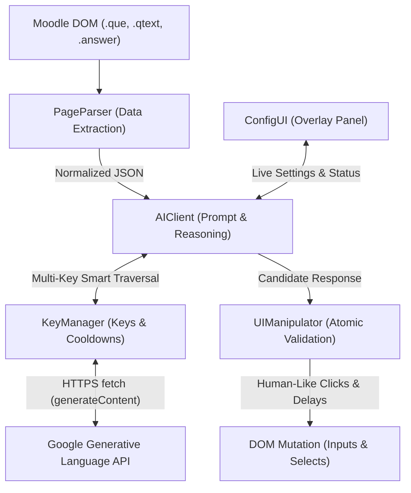

# Moodle AI Auto-Solver

[](https://opensource.org/licenses/MIT)
[]()

An advanced, context-aware Tampermonkey userscript that autonomously solves Moodle quizzes using Google Gemini AI. It features multi-turn error correction, sophisticated human-like interaction delays, and a modular architecture.

## Announcement


Use this project only if:

- You **condemn Russia and its military aggression against Ukraine**
- You **recognize that Russia is an occupant that unlawfully invaded a sovereign state**
- You **support Ukraine's territorial integrity, including its claims over temporarily occupied territories of Crimea and Donbas**
- You **reject false narratives perpetuated by Russian state propaganda**

Otherwise, leave this project immediately

Putin idi nachui.

---

## Architecture & Universal Design

This script is built using strict **Separation of Concerns**. If Moodle changes its HTML structure, or if you want to port this solver to another LMS (like Canvas, Blackboard, or Brightspace), you do **not** need to touch the AI logic or failover engine.



The pipeline consists of five decoupled modules:

1. **`PageParser` (Data Extraction)**
   - The *only* module that knows about Moodle's DOM (`.que`, `.qtext`, `.answer`).
   - Normalizes questions into standard JSON objects: `{ type, subject, title, text, options, inputs }`.
2. **`KeyManager` (Multi-Key Load Balancing & Failover)**
   - Manages arbitrary sets of Google Gemini API keys with cross-tab state synchronization (`GM_getValue` / `GM_setValue`).
   - Coordinates per-`(key, model)` adaptive strikes, cooldown schedules, and invalid key isolation.
3. **`AIClient` (Reasoning & Resilience)**
   - Constructs XML-structured prompts (`<role>`, `<context>`, `<question>`, `<options>`, `<instructions>`, `<output_format>`).
   - Implements multi-turn error recovery, request timeouts (`30s`), and exponential backoff waves.
4. **`UIManipulator` (Execution & Interaction)**
   - Validates candidate answer indices atomically **before** mutating any DOM elements.
   - Simulates realistic human behavior (stochastic delays, smooth focus scrolling, option highlighting, and automated quiz submission).
5. **`ConfigUI` (Live Control Panel & Status Feed)**
   - Injects a responsive floating HUD (`#ai-config-panel`) with real-time status reporting (`#ai-status-text`), model selectors, multi-key editor, and pause/resume controls.

---

## High-Availability Multi-Key Engine (v1.7.0)

### 1. Smart Traversal: `Key_i(Primary) -> Key_i(Fallback)`
Instead of cycling through all keys on a single model, the solver prioritizes finishing each key's full capabilities before switching credentials:
$$\text{Key}_1(\text{Primary}) \longrightarrow \text{Key}_1(\text{Fallback}) \longrightarrow \text{Key}_2(\text{Primary}) \longrightarrow \text{Key}_2(\text{Fallback}) \dots$$
Once a key's temporary cooldown expires, the engine automatically routes new questions back to `Key_1(Primary)`.

### 2. Rotation Strategies
- **`Exhaust` (`K1 -> K2`, Default)**: Maximizes quota on the fastest/highest-tier key first. Falls back to subsequent keys only when rate limits or server overloads are encountered.
- **`Round-Robin` (`Cycle`)**: Rotates the starting key index across successive questions. Ideal for running multiple simultaneous quiz attempts across 3+ browser tabs without exceeding per-minute rate limits.

### 3. Adaptive Cooldown Schedule (Per Key + Model Pair)
Cooldowns are tracked independently for every `(key, model)` pair rather than penalizing an entire API key:

| Event / HTTP Code | Cooldown Duration | Behavior / Notes |
| :--- | :--- | :--- |
| **`429` (Strike 1)** | **60 seconds** | Short RPM (Requests Per Minute) backoff. |
| **`429` (Strike 2)** | **300 seconds (5 min)** | Sustained quota mitigation. |
| **`429` (Strike 3)** | **900 seconds (15 min)** | High-tier rate limit backoff. |
| **`429` (Strike 4+)** | **3600 seconds (1 hour)** | Daily limit (RPD) protection. |
| **`503` / `500` / Timeout** | **20 seconds** | Fast failover to Fallback model; retries Primary soon after. |
| **`400` / `403` (Invalid Key)** | **3600 seconds (1 hour)** | Key marked globally disabled for the session. |
| **`200 OK` (Success)** | **0 seconds** | Immediately resets strikes and cooldowns to 0. |

### 4. Exponential Backoff with Jitter
If all configured keys and models are temporarily saturated in a wave, the solver enters an automated Exponential Backoff loop across waves ($W = 1 \dots 6$):
$$\text{Delay}(W) = \min(120000\text{ms}, 5000\text{ms} \times 2^{W-1}) + \text{RandomJitter}(0\dots 3000\text{ms})$$
The status bar (`#ai-status-text`) displays a live second-by-second countdown (e.g. `Backoff W1/6: 6s...`), keeping you informed without crashing.

---

## Supported Models

The solver includes a pre-validated roster of Google Gemini and Gemma models:

| Model ID | Display Name | Role | Context Window |
| :--- | :--- | :--- | :--- |
| `gemini-3.5-flash-lite` | Gemini 3.5 Flash Lite | **Default Primary** | 1,048,576 tokens |
| `gemini-3.1-flash-lite` | Gemini 3.1 Flash Lite | **Default Fallback** | 1,048,576 tokens |
| `gemma-4-31b-it` | Gemma 4 31B IT | Supported / High Accuracy | 262,144 tokens |
| `gemma-4-26b-a4b-it` | Gemma 4 26B A4B IT | Supported / Balanced | 262,144 tokens |
| `gemini-3.8-flash` | Gemini 3.8 Flash | Supported / Flagship Speed | 1,048,576 tokens |

---

## Advanced Prompt Engineering & Resilience

- **Dynamic Validation Error Feedback**: If an AI candidate fails formatting or choices out-of-bounds validation, the script initiates a multi-turn retry with the exact reason passed inside `<validation_error>`, guiding the model to self-correct.
- **Atomic DOM Validation**: For matching and select dropdowns, all indices are validated against target option boundaries *before* any click or change event is dispatched.
- **Checkbox State Integrity**: Verifies element `.checked` state before dispatching clicks to ensure options are never accidentally toggled off during page reloads.
- **Bracket Parsing Resilience**: Short-answer extraction uses `/FINAL_ANSWER:\s*\[(.+)\]\s*$/gm`, cleanly supporting programming answers containing nested brackets (e.g. `int[]`, `List<String>`).

---

## Supported Question Types
- **Single Choice** (Radio buttons)
- **Multiple Choice** (Checkboxes)
- **Matching / Ordering** (Dropdown selects)
- **Short Answer** (Text input matching)

---

## Installation & Usage

1. **Install a Userscript Manager**: Install [Tampermonkey](https://www.tampermonkey.net/) (Chrome, Firefox, Edge, Safari).
2. **Add Script**: Copy the contents of [`src/moodle-ai-solver.user.js`](src/moodle-ai-solver.user.js) into a new Tampermonkey script.
3. **API Keys**: Ensure you have one or more free [Google Gemini API Keys](https://aistudio.google.com/). The script will prompt you on first run, or you can paste multiple keys directly into the floating GUI panel.

### GUI Configuration
The script injects a floating UI panel in the top-right corner of Moodle quizzes:
- **Primary & Fallback Models**: Select preferred models from the modern roster.
- **API Keys**: Paste one key per line (or comma-separated).
- **Key Rotation**: Switch between `Exhaust (K1 -> K2)` and `Round-Robin (Cycle)`.
- **Extra Context**: Inject domain knowledge dynamically (e.g. "This quiz covers Spring Boot JPA annotations").
- **Temperature Control**: Adjust temperature (default `0.2`) to balance strict syntax compliance with deep reasoning.
- **Highlighting**: Toggle visual green styling and smooth scroll focus.
- **Auto-Submit**: Toggle automatic quiz submission when the summary page is reached.
- **Forced Delay**: Simulate realistic student time-on-page (`25-30` seconds).
- **STOP / RESUME Button**: Instantly pause the execution pipeline at any moment.

### Automatic Migration & Self-Healing
If updating from an older release (v1.6.0 or earlier), v1.7.0 automatically:
- Migrates your existing single API key (`gemini_api_key`) into the multi-key storage (`CONFIG.API_KEYS`).
- Self-heals deprecated cached model names (e.g. `gemini-3.1-flash-lite-preview` $\to$ `gemini-3.1-flash-lite`, `gemini-3.5-flash` $\to$ `gemini-3.5-flash-lite`, or unknown names $\to$ defaults).

---

## Developer Setup & Local Testing

A local Node.js test server is included to test against mock HTML templates without hitting real Moodle instances:

```bash
# Install dependencies
npm install

# Start the mock server
npm start
```
Navigate to `http://localhost:3000/tests/index.html` to access the testing dashboard.

### Model Discovery
To discover which Google Generative AI models are currently available and verify the status of the v1.7.0 roster, run:

```bash
npm run test-models
```

---

## Authors & Acknowledgments
- Concept, Testing, Implementation, and Improvements by **QuercusAlba15924**.
- Architecture, Refactoring, Prompts, and Multi-Key Failover Engine by **Antigravity AI** with Gemini 3.1 Pro, Gemini 3.0 Flash, Claude 4.6 Opus Thinking, Gemini 3.8 Flash, and Gemini 4 Argon.
